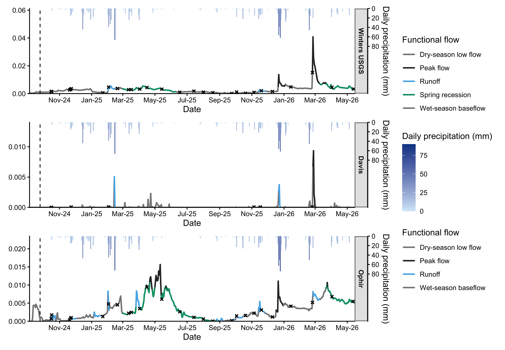

ERDC Davis Fire MS
================
K. Loria
2026-11-16

- [Shared analysis parameters](#shared-analysis-parameters)
- [Helper functions](#helper-functions)
- [Import input datasets](#import-input-datasets)
- [I. Characterize hydroclimate
  conditions](#i-characterize-hydroclimate-conditions)
  - [Figure 2. Streamflow, precipitation, and sampling
    timing](#figure-2-streamflow-precipitation-and-sampling-timing)
  - [Runoff and sampling timing as streamflow, sample dates, and
    ppt](#runoff-and-sampling-timing-as-streamflow-sample-dates-and-ppt)
  - [Look at largest flow events:](#look-at-largest-flow-events)
  - [Look at largest pp† events:](#look-at-largest-pp-events)
  - [baseflow transition?](#baseflow-transition)
- [II. Differences in solute
  concentrations](#ii-differences-in-solute-concentrations)
  - [Catchment water quality
    differences](#catchment-water-quality-differences)
  - [Suppporting info table](#suppporting-info-table)

## Shared analysis parameters

``` r
# Site colors, labels, and plotting order

site_colors <- c(
  "Ophir" = "#7d5ba6",
  "Winters" = "#8b9933",
  "Winters upstream" = "#b6cf15",
  "Davis" = "#e2d346",
  "Browns" = "#117733",
  "Browns sub" = "#10de54"
)

site_lab_colors <- c(
  "ophir" = "#7d5ba6",
  "ophir_hw" = "#7d1ba6",
  "winters_usgs" = "#8b9933",
  "winters_up" = "#b6cf15",
  "davis" = "#e2d346",
  "browns" = "#117733",
  "browns_sub" = "#10de54"
)

creek_levels <- c(
  "Browns Creek",
  "Winters Creek",
  "Davis Creek",
  "Ophir Creek"
)

site_labels <- c(
  "browns" = "Browns",
  "browns_sub" = "Browns sub.",
  "winters_usgs" = "Winters USGS",
  "winters_up" = "Winters up",
  "davis" = "Davis",
  "ophir" = "Ophir"
)

site_shapes <- c(
  "ophir" = 16,
  "ophir_hw" = 17,
  "winters_usgs" = 16,
  "winters_up" = 17,
  "davis" = 16,
  "browns" = 16,
  "browns_sub" = 15,
  "browns_hw" = 17
)

# Davis Fire containment date
ref_date <- as.Date("2024-09-25")
```

## Helper functions

``` r
# Assign water year (October 1 – September 30)
water_year <- function(data) {
  data %>%
    mutate(
      date = as.Date(date),
      WaterYear = if_else(
        month(date) >= 10,
        year(date) + 1L,
        year(date)
      )
    )
}
```

## Import input datasets

``` r
# Water quality observations
WC_dat <- read.csv(
  file.path(data_dir, "DF_water_quality_data_2026.csv")
) %>%
  mutate(
    datetime = ymd_hms(datetime, tz = "UTC"),
    datetime = with_tz(datetime, tzone = local_tz),
    date = as.Date(datetime, tz = local_tz),
    year = year(datetime),
    mon = month(datetime),
    jday = yday(datetime),
    burn_lab = case_when(
      site_lab == "ophir" ~ "unburned",
      site_lab %in% c(
        "davis",
        "winters_usgs",
        "winters_up",
        "browns",
        "browns_sub"
      ) ~ "burn",
      TRUE ~ NA_character_
    )
  )
```

``` r
# Daily discharge and precipitation observations
df_hydro <- read.csv(
  file.path(data_dir, "hydro_clim_WY2024_2026.csv")
) %>%
  mutate(
    date = as.Date(date, format = "%Y-%m-%d")
  )
```

## I. Characterize hydroclimate conditions

- How do sampling events reflect baseflow or runoff conditions?
- When did the largest transport events occur at each site?

### Figure 2. Streamflow, precipitation, and sampling timing

### Runoff and sampling timing as streamflow, sample dates, and ppt



### Look at largest flow events:

    ## # A tibble: 30 × 7
    ##    site     water_year date            Q precip_mm ppt_3day functional_component
    ##    <chr>         <int> <date>      <dbl>     <dbl>    <dbl> <chr>               
    ##  1 browns         2025 2025-08-19 0.0202      0        0    <NA>                
    ##  2 browns         2025 2025-09-24 0.0148      0        0    <NA>                
    ##  3 browns         2026 2026-02-24 0.119       0.31     0.31 peak_flow           
    ##  4 browns         2026 2026-03-17 0.103       0        0    <NA>                
    ##  5 browns_…       2025 2025-08-19 0.0298     NA       NA    <NA>                
    ##  6 browns_…       2025 2025-09-24 0.0188     NA       NA    <NA>                
    ##  7 browns_…       2026 2026-02-24 0.0621     NA       NA    peak_flow           
    ##  8 browns_…       2026 2026-03-17 0.0566     NA       NA    <NA>                
    ##  9 davis          2024 2024-03-20 0.081       0        0.38 peak_flow           
    ## 10 davis          2024 2024-03-23 0.0498      9.7      9.7  peak_flow           
    ## # ℹ 20 more rows

### Look at largest pp† events:

    ## # A tibble: 36 × 7
    ##    site    water_year date             Q precip_mm ppt_3day functional_component
    ##    <chr>        <int> <date>       <dbl>     <dbl>    <dbl> <chr>               
    ##  1 browns        2024 2023-10-01 NA          NA       NA    <NA>                
    ##  2 browns        2024 2023-10-02 NA          NA       NA    <NA>                
    ##  3 browns        2025 2025-08-19  0.0202      0        0    <NA>                
    ##  4 browns        2025 2025-09-24  0.0148      0        0    <NA>                
    ##  5 browns        2026 2025-10-03  0.0249     19.8     19.8  <NA>                
    ##  6 browns        2026 2026-04-02  0.0672      8.07     8.07 <NA>                
    ##  7 browns…       2024 2023-10-01 NA          NA       NA    <NA>                
    ##  8 browns…       2024 2023-10-02 NA          NA       NA    <NA>                
    ##  9 browns…       2025 2024-10-01 NA          NA       NA    <NA>                
    ## 10 browns…       2025 2024-10-02 NA          NA       NA    <NA>                
    ## # ℹ 26 more rows

### baseflow transition?

    ## # A tibble: 12 × 9
    ##    site   water_year dry_season_onset onset_DOY onset_Q sept_mean_Q low_flow_min
    ##    <chr>       <int> <date>               <dbl>   <dbl>       <dbl>        <dbl>
    ##  1 browns       2025 2025-08-19             231  0.0202     0.0148      0.0037  
    ##  2 brown…       2025 2025-08-19             231  0.0298     0.0188      0.0047  
    ##  3 davis        2024 2024-07-07             189  0          0           0       
    ##  4 davis        2025 2025-04-02              92  0          0           0       
    ##  5 davis        2026 2026-04-01              91  0          0           0       
    ##  6 ophir        2024 2024-04-01              92  0.140      0.0915      0.0229  
    ##  7 ophir        2025 2025-08-02             214  0.0193     0.0123      0.00308 
    ##  8 ophir        2026 2026-07-01             182  0.0176     0.0114      0.00284 
    ##  9 winte…       2025 2025-08-19             231  0.0181     0.0128      0.0032  
    ## 10 winte…       2024 2024-06-21             173  0.0065     0.00389     0.000973
    ## 11 winte…       2025 2025-08-31             243  0.002      0.00116     0.000291
    ## 12 winte…       2026 2026-06-14             165  0.0082     0.00512     0.00128 
    ## # ℹ 2 more variables: low_flow_max <dbl>, functional_component <chr>

Only valid for sites with USGS gages.

## II. Differences in solute concentrations

### Catchment water quality differences

#### Boxplot of solutes


### Suppporting info table

Water chemistry mean, median, range

    ## # A tibble: 108 × 8
    ##     Site  Analyte Units `Site samples (n)` `Analyte samples (n)`    Mean  Median
    ##     <fct> <fct>   <chr>              <int>                 <int>   <dbl>   <dbl>
    ##   1 Brow… DOC     mg/L                  19                    19 2.77e+0 2.69e+0
    ##   2 Brow… TOC     mg/L                  19                    18 2.79e+0 2.51e+0
    ##   3 Brow… TDN     mg/L                  19                    19 1.1 e-1 9.6 e-2
    ##   4 Brow… NO₃-N   mg/L                  19                    17 3.8 e-2 1   e-2
    ##   5 Brow… NH₄-N   mg/L                  19                    17 5.4 e-2 5   e-2
    ##   6 Brow… PO₄-P   mg/L                  19                    17 5.2 e-2 3.7 e-2
    ##   7 Brow… TSS     mg/L                  19                    15 1.65e+1 3.5 e+0
    ##   8 Brow… Al      µg/L                  19                    19 5.48e+0 4.1 e+0
    ##   9 Brow… As      µg/L                  19                    19 1.65e-1 1.4 e-1
    ##  10 Brow… B       µg/L                  19                    19 3.63e+0 4.1 e+0
    ##  11 Brow… Ba      µg/L                  19                    19 2.98e+1 2.47e+1
    ##  12 Brow… Ca      µg/L                  19                    19 1.62e+3 1.58e+3
    ##  13 Brow… Cr      µg/L                  19                    18 9.96e+0 5   e-2
    ##  14 Brow… Fe      µg/L                  19                    19 2.43e+2 1.45e+2
    ##  15 Brow… Mn      µg/L                  19                    19 2.37e+1 1.29e+1
    ##  16 Brow… Pb      µg/L                  19                    18 8.68e-1 5   e-2
    ##  17 Brow… Sr      µg/L                  19                    19 1.49e+2 1.34e+2
    ##  18 Brow… Zn      µg/L                  19                    19 6.90e+0 4.4 e+0
    ##  19 Brow… DOC     mg/L                  20                    20 2.28e+0 2.10e+0
    ##  20 Brow… TOC     mg/L                  20                    19 2.37e+0 2.31e+0
    ##  21 Brow… TDN     mg/L                  20                    20 8.4 e-2 8   e-2
    ##  22 Brow… NO₃-N   mg/L                  20                    16 3   e-2 1   e-2
    ##  23 Brow… NH₄-N   mg/L                  20                    17 5.5 e-2 5   e-2
    ##  24 Brow… PO₄-P   mg/L                  20                    15 5.7 e-2 1.5 e-2
    ##  25 Brow… TSS     mg/L                  20                    15 6.93e+0 3.1 e+0
    ##  26 Brow… Al      µg/L                  20                    20 4.95e+0 4.5 e+0
    ##  27 Brow… As      µg/L                  20                    20 1.44e-1 1.35e-1
    ##  28 Brow… B       µg/L                  20                    20 3.76e+0 1.95e+0
    ##  29 Brow… Ba      µg/L                  20                    20 2.19e+1 2.15e+1
    ##  30 Brow… Ca      µg/L                  20                    20 1.34e+3 1.32e+3
    ##  31 Brow… Cr      µg/L                  20                    19 2.04e+1 5   e-2
    ##  32 Brow… Fe      µg/L                  20                    20 2.67e+2 2.05e+2
    ##  33 Brow… Mn      µg/L                  20                    20 2.70e+1 1.63e+1
    ##  34 Brow… Pb      µg/L                  20                    19 7.34e-1 5   e-2
    ##  35 Brow… Sr      µg/L                  20                    20 1.20e+2 1.20e+2
    ##  36 Brow… Zn      µg/L                  20                    20 4.51e+0 2.75e+0
    ##  37 Wint… DOC     mg/L                  23                    23 3.07e+0 2.83e+0
    ##  38 Wint… TOC     mg/L                  23                    21 3.00e+0 2.82e+0
    ##  39 Wint… TDN     mg/L                  23                    23 1.14e-1 1.04e-1
    ##  40 Wint… NO₃-N   mg/L                  23                    21 4.3 e-2 1   e-2
    ##  41 Wint… NH₄-N   mg/L                  23                    21 5   e-2 5   e-2
    ##  42 Wint… PO₄-P   mg/L                  23                    20 4.3 e-2 3.6 e-2
    ##  43 Wint… TSS     mg/L                  23                    19 4.36e+1 2.79e+1
    ##  44 Wint… Al      µg/L                  23                    23 6.80e+0 6.8 e+0
    ##  45 Wint… As      µg/L                  23                    23 1.76e-1 1.6 e-1
    ##  46 Wint… B       µg/L                  23                    22 3.66e+0 3   e+0
    ##  47 Wint… Ba      µg/L                  23                    23 1.15e+1 1.1 e+1
    ##  48 Wint… Ca      µg/L                  23                    23 1.38e+3 1.31e+3
    ##  49 Wint… Cr      µg/L                  23                    21 2.84e+1 1.1 e-1
    ##  50 Wint… Fe      µg/L                  23                    23 5.81e+2 5.36e+2
    ##  51 Wint… Mn      µg/L                  23                    23 2.64e+1 2.13e+1
    ##  52 Wint… Pb      µg/L                  23                    21 1.5 e-1 5   e-2
    ##  53 Wint… Sr      µg/L                  23                    23 9.14e+1 9.11e+1
    ##  54 Wint… Zn      µg/L                  23                    23 2.56e+0 1.7 e+0
    ##  55 Wint… DOC     mg/L                  29                    29 3.66e+0 3.22e+0
    ##  56 Wint… TOC     mg/L                  29                    23 3.25e+0 3.03e+0
    ##  57 Wint… TDN     mg/L                  29                    29 1.38e-1 1.23e-1
    ##  58 Wint… NO₃-N   mg/L                  29                    27 3.5 e-2 1   e-2
    ##  59 Wint… NH₄-N   mg/L                  29                    27 5   e-2 5   e-2
    ##  60 Wint… PO₄-P   mg/L                  29                    26 5.7 e-2 4.6 e-2
    ##  61 Wint… TSS     mg/L                  29                    25 2.80e+1 1.41e+1
    ##  62 Wint… Al      µg/L                  29                    29 6.29e+0 5.4 e+0
    ##  63 Wint… As      µg/L                  29                    29 1.89e-1 1.6 e-1
    ##  64 Wint… B       µg/L                  29                    29 6.22e+0 3.7 e+0
    ##  65 Wint… Ba      µg/L                  29                    29 1.27e+1 1.23e+1
    ##  66 Wint… Ca      µg/L                  29                    29 1.34e+3 1.32e+3
    ##  67 Wint… Cr      µg/L                  29                    28 3.14e+1 5   e-2
    ##  68 Wint… Fe      µg/L                  29                    29 4.35e+2 3.05e+2
    ##  69 Wint… Mn      µg/L                  29                    29 2.97e+1 2.03e+1
    ##  70 Wint… Pb      µg/L                  29                    28 3.1 e-1 5   e-2
    ##  71 Wint… Sr      µg/L                  29                    29 8.83e+1 8.67e+1
    ##  72 Wint… Zn      µg/L                  29                    29 2.72e+0 1.6 e+0
    ##  73 Davis DOC     mg/L                   9                     7 1.05e+1 4.49e+0
    ##  74 Davis TOC     mg/L                   9                     4 1.14e+1 9.34e+0
    ##  75 Davis TDN     mg/L                   9                     7 5.25e-1 2.37e-1
    ##  76 Davis NO₃-N   mg/L                   9                     7 7.4 e-2 6.7 e-2
    ##  77 Davis NH₄-N   mg/L                   9                     7 7   e-2 5   e-2
    ##  78 Davis PO₄-P   mg/L                   9                     6 1.14e-1 6.2 e-2
    ##  79 Davis TSS     mg/L                   9                     8 1.65e+2 1.42e+2
    ##  80 Davis Al      µg/L                   9                     7 1.47e+1 6   e+0
    ##  81 Davis As      µg/L                   9                     7 9.29e-1 5.4 e-1
    ##  82 Davis B       µg/L                   9                     7 1.7 e+1 3.6 e+0
    ##  83 Davis Ba      µg/L                   9                     7 1.6 e+1 5   e-1
    ##  84 Davis Ca      µg/L                   9                     7 5.60e+2 4.62e+1
    ##  85 Davis Cr      µg/L                   9                     7 1.27e+0 3.9 e-1
    ##  86 Davis Fe      µg/L                   9                     7 4.24e+1 2.24e+1
    ##  87 Davis Mn      µg/L                   9                     7 3.28e+1 2.16e+0
    ##  88 Davis Pb      µg/L                   9                     7 1.06e+0 5   e-2
    ##  89 Davis Sr      µg/L                   9                     7 4.32e+1 4.08e+0
    ##  90 Davis Zn      µg/L                   9                     7 3.54e+0 4.1 e+0
    ##  91 Ophir DOC     mg/L                  28                    28 2.33e+0 1.77e+0
    ##  92 Ophir TOC     mg/L                  28                    23 2.04e+0 1.72e+0
    ##  93 Ophir TDN     mg/L                  28                    28 7.4 e-2 7   e-2
    ##  94 Ophir NO₃-N   mg/L                  28                    25 1.1 e-2 1   e-2
    ##  95 Ophir NH₄-N   mg/L                  28                    26 5.4 e-2 5   e-2
    ##  96 Ophir PO₄-P   mg/L                  28                    25 4.1 e-2 4   e-2
    ##  97 Ophir TSS     mg/L                  28                    24 3.82e+1 9.8 e+0
    ##  98 Ophir Al      µg/L                  28                    28 1.18e+1 6.9 e+0
    ##  99 Ophir As      µg/L                  28                    28 1.2 e-1 1.2 e-1
    ## 100 Ophir B       µg/L                  28                    28 4   e+0 2   e+0
    ## 101 Ophir Ba      µg/L                  28                    28 9.77e+0 9.7 e+0
    ## 102 Ophir Ca      µg/L                  28                    28 9.01e+2 8.83e+2
    ## 103 Ophir Cr      µg/L                  28                    27 1.44e+1 5   e-2
    ## 104 Ophir Fe      µg/L                  28                    28 1.56e+2 1.48e+2
    ## 105 Ophir Mn      µg/L                  28                    28 1.63e+1 1.01e+1
    ## 106 Ophir Pb      µg/L                  28                    27 4.23e-1 5   e-2
    ## 107 Ophir Sr      µg/L                  28                    28 7.67e+1 7.64e+1
    ## 108 Ophir Zn      µg/L                  28                    28 4.32e+0 1.15e+0
    ## # ℹ 1 more variable: Range <chr>

end of script
